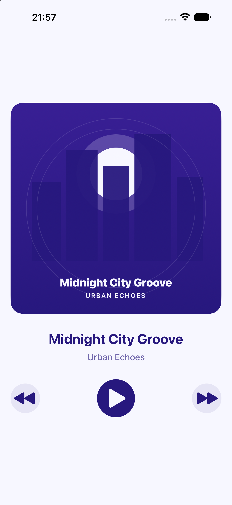

# Music Player — UIStackView & Auto Layout

A clean, adaptive iOS Music Player built with **UIKit**, **UIStackView**, and **Auto Layout** in `Main.storyboard` (with zero programmatic layout constraints). Designed for seamless presentation across all iPhone display sizes, from compact devices like the **iPhone SE (3rd generation)** to large devices like the **iPhone 16 Pro Max**.

---

## 🎨 Theme & Color Palette

The interface is styled with a modern dual-tone aesthetic based on:
- **Persian Indigo** (`#27187E` / `rgb(39, 24, 126)`): Used for primary typography, filled action controls, and album artwork depths.
- **Ghost White** (`#F7F7FF` / `rgb(247, 247, 255)`): Used for the luminous canvas background, primary button icons, and high-contrast accents.
- **Subtle Indigo Tint** (`rgba(39, 24, 126, 0.08)`): Used for the rounded capsule backgrounds of the Previous and Next controls.

---

## 📱 Screenshots & Demo

| iPhone SE (3rd Gen) | iPhone 16 Pro Max |
| :---: | :---: |
|  |  |

### 🎬 Screen Recording Demo
- **File**: [`demo.mp4`](demo.mp4) (Duration: 24 seconds)
- **Demonstrated Features**:
  1. **Play**: Audio playback starts immediately; play button toggles to `pause.fill`.
  2. **Pause**: Audio pauses; button toggles back to `play.fill`.
  3. **Next**: Advances smoothly to the next track with cover, title, and artist crossfading.
  4. **Previous**: Returns to the prior track maintaining current playback state.
  5. **Wrap-Around**: Wrapping from the first track to the 10th track, and from the 10th track back to the 1st track.
  6. **Auto-Advance**: `AVAudioPlayerDelegate.audioPlayerDidFinishPlaying` automatically advances and plays the next track.

---

## 🛠 Features & Architecture

### 1. Pure Storyboard Adaptive Layout
- **Zero layout code in Swift**: No `NSLayoutConstraint`, no layout anchors, no `frame =`, and no manual `addSubview`.
- **Nested Stack View Hierarchy** (3 stack views):
  - **Root Vertical Stack View (`axis = vertical`, `spacing = 32`)**:
    - Pinned to the Safe Area: Leading (+20 pt), Trailing (-20 pt), and Vertically Centered (`centerY == safeArea.centerY`).
  - **Album Cover (`UIImageView`)**:
    - Enforces a strict **1:1 aspect ratio constraint** (`width == height`).
    - Continuous corner radius (24 pt, `.continuous`), subtle border matching the Persian Indigo palette.
    - Scales adaptively with the root stack view across screen widths while remaining perfectly square.
  - **Labels Vertical Stack View (`axis = vertical`, `spacing = 8`)**:
    - `titleLabel`: 26 pt Bold System Font in **Persian Indigo**, centered text alignment.
    - `artistLabel`: 17 pt Medium System Font in **Secondary Persian Indigo** (65% opacity), centered text alignment.
  - **Playback Controls Horizontal Stack View (`axis = horizontal`, `distribution = equalSpacing`, `alignment = center`, `spacing = 24`)**:
    - `previousButton`: 56×56 pt circular capsule in subtle translucent indigo with SF Symbol `backward.fill` in Persian Indigo.
    - `playPauseButton`: 72×72 pt circular capsule in solid **Persian Indigo** with SF Symbol `play.fill` / `pause.fill` in **Ghost White**.
    - `nextButton`: 56×56 pt circular capsule in subtle translucent indigo with SF Symbol `forward.fill` in Persian Indigo.
    - Tactile interactive spring micro-animation upon button tap.
- **Interface Builder Cleanliness**: **Zero warnings and zero errors** (verified with `ibtool` and Xcode Issue Navigator).

### 2. Track Data & Audio Library
- **`Track` Struct**:
  - `title: String`
  - `artist: String`
  - `fileName: String`
  - `coverImageName: String`
  - Computed properties for clean resource loading: `resourceName` and `fileExtension`.
- **`TrackLibrary`**:
  - Static collection containing **10 complete musical tracks**:
    1. *Midnight City Groove* — Urban Echoes (`track01.m4a`, `cover01.png`)
    2. *Sunset Boulevard* — Retro Wave (`track02.m4a`, `cover02.png`)
    3. *Coffee & Rain* — Lo-Fi Dreams (`track03.m4a`, `cover03.png`)
    4. *Cyberpunk Alley* — Synth Rider (`track04.m4a`, `cover04.png`)
    5. *Acoustic Morning* — Gentle Strings (`track05.m4a`, `cover05.png`)
    6. *Solar Flare* — Cosmic Odyssey (`track06.m4a`, `cover06.png`)
    7. *Ocean Breeze* — Chill Coast (`track07.m4a`, `cover07.png`)
    8. *Neon Highway* — Night Cruiser (`track08.m4a`, `cover08.png`)
    9. *Deep Focus* — Ambient Mind (`track09.m4a`, `cover09.png`)
    10. *Golden Hour* — Warm Horizons (`track10.m4a`, `cover10.png`)
- Audio assets are AAC-encoded `.m4a` files (under 130 KB each, well below the 10 MB limit) bundled directly with the application target.
- Custom 800×800 high-resolution album covers designed with Persian Indigo gradients, celestial motifs, and Ghost White typography.

### 3. Playback & State Management (`AVAudioPlayer`)
- Instantiates `AVAudioPlayer` using `Bundle.main.url(forResource:withExtension:)`.
- Configures `AVAudioSession` with `.playback` category for uninterrupted audio playback.
- **Robust Error Handling**: Missing or damaged files do not crash the app; failures are handled gracefully with alerts and console warnings.
- **Auto-Advance**: Implements `AVAudioPlayerDelegate`'s `audioPlayerDidFinishPlaying(_:successfully:)` callback to automatically transition to and start the next track.
- **Circular Bounds (Wrap-Around)**:
  - Next on track 10 $\rightarrow$ wraps to track 1 (`(currentIndex + 1) % count`).
  - Previous on track 1 $\rightarrow$ wraps to track 10 (`(currentIndex - 1 + count) % count`).

---

## 🎓 Oral Defense Q&A

### Q1: Which stack view handles which axis, and why?
- **Root Stack View (`vertical`)**: Stacks the album artwork on top, song metadata in the middle, and playback controls on the bottom in a top-to-bottom vertical column.
- **Labels Stack View (`vertical`)**: Arranges the track title directly above the artist name with tight 8 pt spacing.
- **Controls Stack View (`horizontal`)**: Arranges the Previous, Play/Pause, and Next buttons horizontally side-by-side across the screen.

### Q2: What are the alignment and distribution of each stack, and what would happen if you changed them?
- **Root Stack**: `alignment = fill`, `distribution = fill`. Changing alignment to `center` would prevent the cover and sub-stacks from matching the width of the root stack. Changing distribution to `fillEqually` would force all three child elements (cover, labels, controls) to take equal heights, severely distorting the album art and stretching the controls.
- **Labels Stack**: `alignment = fill`, `distribution = fill`. The labels span the full width of the stack while their text is horizontally centered via `NSTextAlignment.center`.
- **Controls Stack**: `alignment = center`, `distribution = equalSpacing`.
  - `alignment = center` vertically aligns the smaller previous/next buttons (56 pt) with the larger play/pause button (72 pt).
  - `distribution = equalSpacing` spaces the three buttons evenly across the available horizontal width, placing Previous on the leading side, Play/Pause in the exact center, and Next on the trailing side.

### Q3: How does the cover know what size to be without a fixed width or height?
1. The **Root Stack View** is pinned to the Safe Area leading (+20 pt) and trailing (-20 pt). Its width is therefore: $\text{Width} = \text{ScreenWidth} - 40\text{ pt}$.
2. The root stack's `alignment = fill` forces the `coverImageView`'s width to match the root stack's width.
3. The `coverImageView` has an **Aspect Ratio constraint of 1:1** (`width == height`).
4. Therefore, its height automatically matches its width without hardcoding any points. On iPhone SE (width 375 pt), the cover is $335 \times 335$ pt. On iPhone 16 Pro Max (width 440 pt), the cover is $400 \times 400$ pt.

### Q4: What keeps the controls centered and evenly spaced?
- The controls stack view is inside the root stack view, which is pinned with 20 pt margins and centered vertically.
- Inside the controls stack, `distribution = equalSpacing` places equal distance between the items.
- The center Play/Pause button stays exactly centered on screen because the Previous and Next buttons have identical intrinsic widths, and the stack distributes spacing symmetrically.

### Q5: What happens when you tap Next on the last track? Walk through the code.
```swift
@IBAction private func nextButtonTapped(_ sender: UIButton) {
    guard !tracks.isEmpty else { return }

    let wasPlaying = audioPlayer?.isPlaying ?? false
    currentIndex = (currentIndex + 1) % tracks.count
    loadCurrentTrack(autoPlay: wasPlaying, animated: true)
}
```
1. `tracks.count` is 10. When on the last track, `currentIndex` is 9.
2. `(9 + 1) % 10 = 0`, resetting `currentIndex` back to index 0 (the first track).
3. `loadCurrentTrack(autoPlay: wasPlaying, animated: true)` is invoked with `autoPlay` set to whether the player was active before the tap.
4. `loadCurrentTrack` loads `track01.m4a`, crossfades the cover to `cover01.png`, updates the labels to "Midnight City Groove" and "Urban Echoes", and begins playback if it was already playing.

---

## 🚀 How to Build & Run

1. Open `Untitled Project.xcodeproj` in **Xcode 16+**.
2. Select any iOS Simulator run destination (e.g., **iPhone SE (3rd generation)** or **iPhone 16 Pro Max**).
3. Press **Cmd + R** to build and run.
4. *Zero additional setup, cocoapods, or packages required.*
